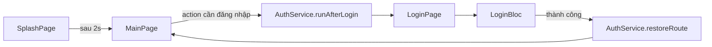

# Kiến trúc

## Các tầng (Layers)

```
lib/
  main/           # entrypoint: main_dev / main_stg / main_prod → mainApp(env) ở main.dart
  app/            # MyApp + AppBloc (theme, ngôn ngữ, debug overlay, cờ dialog lỗi toàn cục)
    themes/       # AppColors, AppShadows
    session/      # AppSessionExpiredHandler — UX hết phiên (implement SessionExpiredHandler)
  config/         # EnvironmentBase, AppConfig
  navigation/     # AppNavigator, router_paths, app_router
  di/             # di.dart + di.config.dart (GENERATED)
  domain/         # entity, body, param, use case, repository interface của app
  data/           # REST client, interceptor, session port (data/api/session/), model, mapper
  presentation/   # features, widgets, dialogs, bottom_sheets, snack_bar, helpers
  l10n/           # intl_*.arb
```

Primitive dùng chung nằm trong `commons/packages/*` (base BLoC, storage, network, router, design
system).

Tooling: mason bricks (`bricks/screen_brick`, `domain_brick`, `data_brick`) + script
`bricks/shell_scripts/*.sh`; codegen bằng `dart run build_runner build --delete-conflicting-outputs`.

---

## Cấu trúc màn hình (`presentation/features/`)

### Lõi bắt buộc (mọi màn hình)

```
<screen>/
  bloc/
    bloc.dart          ← re-export
    <screen>_bloc.dart
    <screen>_event.dart
    <screen>_state.dart
  <screen>_page.dart
```

### Base project — 1 cấp

App mẫu nhỏ, mỗi màn ngang hàng:

```
features/
  splash/    login/    main/
```

### Parent / Tutor — 2 cấp + mở rộng

App production nhóm theo domain, thêm folder phụ khi UI lớn:

```
features/
  order/
    order_detail/     bloc/ + order_detail_page.dart
    order_list/       bloc/ + order_list_page.dart
  personal/
    my_profile/       bloc/ + page + widgets/ + helper *.dart
  authentication/
    login/            bloc/ + login_page.dart + widgets/
```

| Thêm gì                                            | Khi nào                            |
|----------------------------------------------------|------------------------------------|
| `features/<domain>/`                               | ≥ 2 màn cùng nghiệp vụ             |
| Helper `_build...()` trong `<screen>_page.dart`    | Page không quá 400 dòng            |
| `<screen>/widgets/`                                | Page trên 400 dòng, tách widget con |
| `lib/presentation/widgets/<widget>.dart`           | Widget dùng lại ở ≥ 2 màn/feature  |
| File helper local (`*_calculator.dart`, `models/`) | Logic/view chỉ thuộc 1 màn         |

### Template code

#### `screen_brick` khi tạo mới màn hình

##### `{{name.snakeCase()}}/bloc/bloc.dart`

```dart
export 'package:base_project/presentation/features/{{name.snakeCase()}}/bloc/{{name.snakeCase()}}_bloc.dart';
export 'package:base_project/presentation/features/{{name.snakeCase()}}/bloc/{{name.snakeCase()}}_event.dart';
export 'package:base_project/presentation/features/{{name.snakeCase()}}/bloc/{{name.snakeCase()}}_state.dart';
```

##### `{{name.snakeCase()}}/bloc/{{name.snakeCase()}}_bloc.dart`

```dart
import 'dart:async';

import 'package:domain/domain.dart';
import 'package:base_ui/base_ui.dart';
import 'package:base_project/presentation/features/{{name.snakeCase()}}/bloc/{{name.snakeCase()}}_event.dart';
import 'package:base_project/presentation/features/{{name.snakeCase()}}/bloc/{{name.snakeCase()}}_state.dart';
import 'package:injectable/injectable.dart';
import 'package:flutter_bloc/flutter_bloc.dart';

@Injectable()
class {{name.pascalCase()}}Bloc extends BaseBloc<{{name.pascalCase()}}Event, {{name.pascalCase()}}State> {
{{name.pascalCase()}}Bloc(
)
    : super(const {{name.pascalCase()}}State()) {
on<Initial{{name.pascalCase()}}DataEvent>(_onInitialDataEvent);
}

FutureOr<void> _onInitialDataEvent(
Initial{{name.pascalCase()}}DataEvent event,
Emitter<{{name.pascalCase()}}State> emit,
) {}

}
```

##### `{{name.snakeCase()}}/bloc/{{name.snakeCase()}}_event.dart`

```dart
import 'package:base_ui/base_ui.dart';
import 'package:domain/domain.dart';

abstract
class {{name.pascalCase()}}Event extends BaseBlocEvent {
const {{name.pascalCase()}}Event();
}

class Initial{{name.pascalCase()}}DataEvent extends {{name.pascalCase()}}Event {
const Initial{{name.pascalCase()}}DataEvent();
}
```

##### `{{name.snakeCase()}}/bloc/{{name.snakeCase()}}_state.dart`

```dart
import 'package:base_ui/base_ui.dart';
import 'package:domain/domain.dart';
import 'package:freezed_annotation/freezed_annotation.dart';

part '{{name.snakeCase()}}_state.freezed.dart';

@freezed
abstract
class {{name.pascalCase()}}State extends BaseBlocState with _${{name.pascalCase()}}State {
const {{name.pascalCase()}}State._();

const factory {{name.pascalCase()}}State({
@Default(LoadingStatus.initial) LoadingStatus? loadStatus,
}) = _{{name.pascalCase()}}State;
}
```

##### `{{name.snakeCase()}}/{{name.snakeCase()}}_page.dart`

```dart
import 'package:flutter/material.dart';
import 'package:base_ui/base_ui.dart';
import 'package:base_project/presentation/features/{{name.snakeCase()}}/bloc/bloc.dart';
import 'package:base_project/presentation/widgets/core/layout_page.dart';
import 'package:flutter_bloc/flutter_bloc.dart';

class {{name.pascalCase()}}Arguments {
const {{name.pascalCase()}}Arguments();
}

class {{name.pascalCase()}}Page extends StatefulWidget {
final {{name.pascalCase()}}Arguments? arguments;

const {{name.pascalCase()}}Page(
{super.key, this.arguments});
@override
State<{{name.pascalCase()}}Page> createState() => _{{name.pascalCase()}}PageState();
}

class _{{name.pascalCase()}}PageState extends BasePageState<{{name.pascalCase()}}Page, {{name.pascalCase()}}Bloc> {

@override
void initState() {
super.initState();
}

@override
Widget buildPage(BuildContext context) {
return LayoutPage(
body: SizedBox(),
);
}
}
```

Template code đầy đủ: [`PROJECT.md`](../PROJECT.md) phần "Tạo màn hình mới".

#### `domain_brick` sau khi thêm 1 api và cần handler model

#####
`lib/domain/models/entity/{{feature_name.snakeCase()}}/{{entity_name.snakeCase()}}_entity.dart`

```dart
class {{entity_name.pascalCase()}}Entity {
final int? id;

    {{entity_name.pascalCase()}}Entity({
    this.id,
    });
    }
```

#### `data_brick` sau khi thêm 1 api và cần handler model

##### `lib/data/mapper/{{feature_name.snakeCase()}}/{{entity_name.snakeCase()}}_mapper.dart`

```dart
import 'package:base_project/data/models/{{feature_name.snakeCase()}}/{{entity_name.snakeCase()}}_response.dart';
import 'package:base_project/domain/domain.dart';

class {{entity_name.pascalCase()}}Mapper {
static {{entity_name.pascalCase()}}Entity mapToEntity({{entity_name.pascalCase()}}Response dto) {
return {{entity_name.pascalCase()}}Entity(
id: dto.id,
);
}
}
```

##### `lib/data/models/{{feature_name.snakeCase()}}/{{entity_name.snakeCase()}}_response.dart`

```dart
import 'package:freezed_annotation/freezed_annotation.dart';

part '{{entity_name.snakeCase()}}_response.g.dart';

part '{{entity_name.snakeCase()}}_response.freezed.dart';

@freezed
abstract
class {{entity_name.pascalCase()}}Response with _${{entity_name.pascalCase()}}Response {
const factory {{entity_name.pascalCase()}}Response({
int? id,
}) = _{{entity_name.pascalCase()}}Response;

factory {{entity_name.pascalCase()}}Response.fromJson(Map<String, dynamic> json) =>
_${{entity_name.pascalCase()}}ResponseFromJson(json);
}
```

---

## Cấu hình / môi trường

Giá trị theo môi trường nằm trong [`lib/config/environment.dart`](../../lib/config/environment.dart):

```
EnvironmentBase.dev / staging / prod
    ↓  main_dev.dart → mainApp(EnvironmentBase.dev)
GetIt<EnvironmentConfig>
    ↓
Toàn bộ app (getBaseUrl, getClientId, …)
```

Ba entrypoint (`main_dev` / `main_stg` / `main_prod`) chọn instance tương ứng; chạy bằng
`flutter run -t lib/main/main_<env>.dart`. Base chưa khai flavor native. Dev đổi server không sửa
code: `--dart-define=API_BASE_URL=…`. Fork app → sửa các field trong `EnvironmentBase`.

---

## Thứ tự bootstrap

`main_*.dart` → `mainApp(config)` (`lib/main/main.dart`):

1. `WidgetsFlutterBinding.ensureInitialized()`
2. `HydratedBloc.storage` init
3. Alice attach (non-production)
4. `EnvConstants.init()`
5. `SharedConfig` → `DataConfig` → `DomainConfig` → `RouterConfig` → `BaseUiConfig` → `AppConfig`
6. `ShowLoadingUtils.instance.setValueColor(AppColors.primary)`
7. `runApp(MyApp())`

Trong `MyApp`: đăng ký route (`AppRouter.routerConfiguration()`), rồi `_initConfig()` sau frame đầu
(chỗ gắn Firebase/FCM khi dự án cần — base để comment sẵn).

`AppConfig.config()` gọi `configureInjection()` để đăng ký DI cấp app.

---

## Luồng điều hướng



- Base mở thẳng `MainPage`; màn/hành động cần đăng nhập bọc qua `AuthService.runAfterLogin` (router
  guard tự lưu và khôi phục route).
- `LoginPage` của base là login mẫu. Thành công → `AuthService.restoreRoute(...)`.
- **BLoC không bao giờ navigate** — page làm việc đó.
- Mọi path truyền vào `AppNavigator`, `GoRouter` hoặc API navigation tương đương phải lấy từ
  `RouterPaths`; cấm string literal như `AppNavigator.go('/payment-transactions')`.
- Route có query/deep-link variant phải có constant hoặc helper mang tên rõ nghĩa trong `RouterPaths`;
  cấm ghép path/query bằng interpolation tại call site. Ví dụ đúng:
  `AppNavigator.go(RouterPaths.createOrder)`.
- Route registration cũng dùng `RouterPaths`, không khai lại cùng path bằng text ở router config.

---

## Session

- Token (access/refresh) lưu qua `AppPreferences` của package `data`.
- Đăng xuất: `DeleteTokenUseCase` (xoá token) + `AuthService.logout()` (báo router guard).
- Hết phiên: `RefreshTokenInterceptor` refresh một lần cho mọi 401 đồng thời; server từ chối refresh
  (`RemoteExceptionKind.refreshTokenFailed`) → reject cả hàng đợi rồi gọi `SessionExpiredHandler`.
  Lỗi mạng lúc refresh **không** coi là hết phiên.

---

## Extension points

| Điểm mở rộng                | Vị trí                                  | Thay bằng                          |
|-----------------------------|-----------------------------------------|------------------------------------|
| `LoginBloc` / `LoginPage`   | `lib/presentation/features/login/`      | API login thật                     |
| `AppSessionExpiredHandler`  | `lib/app/session/`                      | UX hết phiên riêng của app         |
| `RefreshTokenApiService`    | `lib/data/api/service/`                 | endpoint + body refresh của backend |
| `MainPage`                  | `lib/presentation/features/main/`       | shell app thật                     |
| `EnvironmentBase`           | `lib/config/environment.dart`           | URL / clientId theo môi trường     |
| `AppColors` / `AppShadows`  | `lib/app/themes/`                       | Design System của dự án (giữ tên token) |

---

## Module tùy chọn

Base không include sẵn để giữ project nhẹ. Dự án cần thì thêm thủ công (tham khảo dự án đã làm,
ví dụ `smart_toy_mobile`):

| Module       | Thêm gì                                                                                   | Còn phải làm native |
|--------------|-------------------------------------------------------------------------------------------|---------------------|
| Firebase/FCM | `firebase_core/messaging/analytics/crashlytics` (đang comment trong `pubspec.yaml` + `my_app.dart`), `config/fcm_config.dart` | `flutterfire configure`, `google-services.json`, APNs |
| Deep link    | `app_links`, `config/deep_link_service.dart`, mapper URI → route, listener trong `MyApp` | `AndroidManifest.xml` intent-filter, iOS Associated Domains |
| GraphQL      | `graphql_codegen` + `lib/data/api/graphql/`                                              | `build.yaml` + file `.graphql` |

---

## Networking

`RefreshTokenInterceptor`: một lần refresh cho 401 đồng thời, queue/replay request, refresh thất bại →
reject hàng đợi + `SessionExpiredHandler` (interceptor không navigate, không mở dialog). UX lỗi qua
`AppExceptionImpl`: lỗi mạng/server/validation → `AppSnackBar`; timeout → dialog thử lại; cờ
`AppState.showErrorDialog` chặn mở chồng dialog lỗi.

> **Endpoint API:** chỉ định nghĩa trong `lib/data/api/service/app_api_service.dart` / `AppApiService`; không tạo service hoặc file endpoint theo feature. Xem `DOMAIN-DATA-CONVENTIONS.md` mục “Nơi duy nhất khai báo endpoint API của ứng dụng”.
